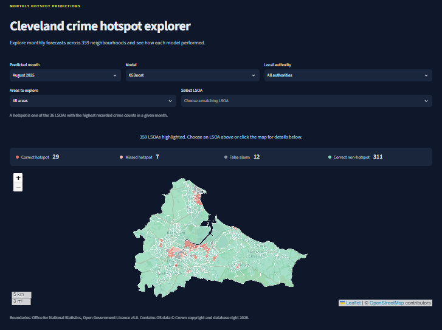

# Predicting crime hotspots in Cleveland

**[Open the app](https://cleveland-crime-hotspot-prediction.streamlit.app/)**



This project investigates how well machine learning and time-series models can predict next-month crime hotspots across the Cleveland Police force area. It includes the original research notebooks, data and results, alongside a Streamlit app for exploring the predictions interactively.

## Data and approach

The study covers **359 Lower Layer Super Output Areas (LSOAs)** across Hartlepool, Middlesbrough, Redcar and Cleveland, and Stockton-on-Tees. Recorded crime and ASB data span **April 2023-March 2026**.

A hotspot is one of the **36 LSOAs with the highest recorded incident counts in a month**.

The analysis combines previous crime counts, rolling averages, neighbouring-area patterns, deprivation, weather and holiday indicators. 4 models are compared: **Persistence, Logistic regression, ARIMA and XGBoost**. Evaluation covers 8 target months, **August 2025-March 2026**.

## Main findings

Most areas keep the same hotspot status from month to month, allowing the persistence baseline to achieve **94.7% overall accuracy**. The research therefore also examines areas near the hotspot cutoff and those changing status.

In the original analysis, XGBoost achieved **66.7% accuracy near the cutoff**, compared with **53.0% for persistence**. This group contains areas ranked 26-46 in the observation month. The main finding is that evaluating these more difficult cases reveals differences that overall accuracy can hide.

The research also explores how prediction errors vary with area characteristics. Results describe recorded incidents, reporting patterns and the use of counts rather than population adjusted rates affect their interpretation.

## Project contents

| Folder | Contents |
| --- | --- |
|`Scripts/` | Notebooks for cleaning, exploration, feature engineering, modelling, boundary analysis and fairness analysis |
| `Data/` | Source data and prepared datasets |
| `*_outputs/` | Saved charts and research results |
| `App/` | Streamlit app and supporting files |

The notebooks are numbered in running order, from **1 to 6**. Open a terminal in the main project folder and launch Jupyter from the `Scripts` folder:

```bash
cd Scripts
python -m jupyterlab
```
JupyterLab and the Python packages imported by the notebooks must be installed before running them.
Prepared data and saved results are included. Rerunning the notebooks will update their corresponding files.

## Interactive app

The Streamlit app provides an interactive LSOA map, monthly predictions, area-level incident histories and model comparisons.

The app includes corrections to ARIMA forecast alignment and XGBoost threshold selection, therefore some results differ from the original research figures above. Both versions are retained separately. The app uses the same test period.

To run the app with Python 3.12, use these commands from the repository's main folder:

```bash
cd App
python -m pip install -r requirements.txt
python -m streamlit run app.py
```

Predictions are included, so launching the app does not require model training. Street-map tiles require an internet connection.

To regenerate the app’s data using the scripts in `App/scripts/`, install the additional packages from inside the `App` folder:

```bash
python -m pip install -r requirements-build.txt
```

This is optional, the prepared data needed to run the app are already included.

## Data sources

Crime and ASB records come from data.police.uk, boundaries and census data from ONS, deprivation data from the English Indices of Deprivation 2025, weather data from Open-Meteo. Holiday indicators cover bank holidays and school holidays.


